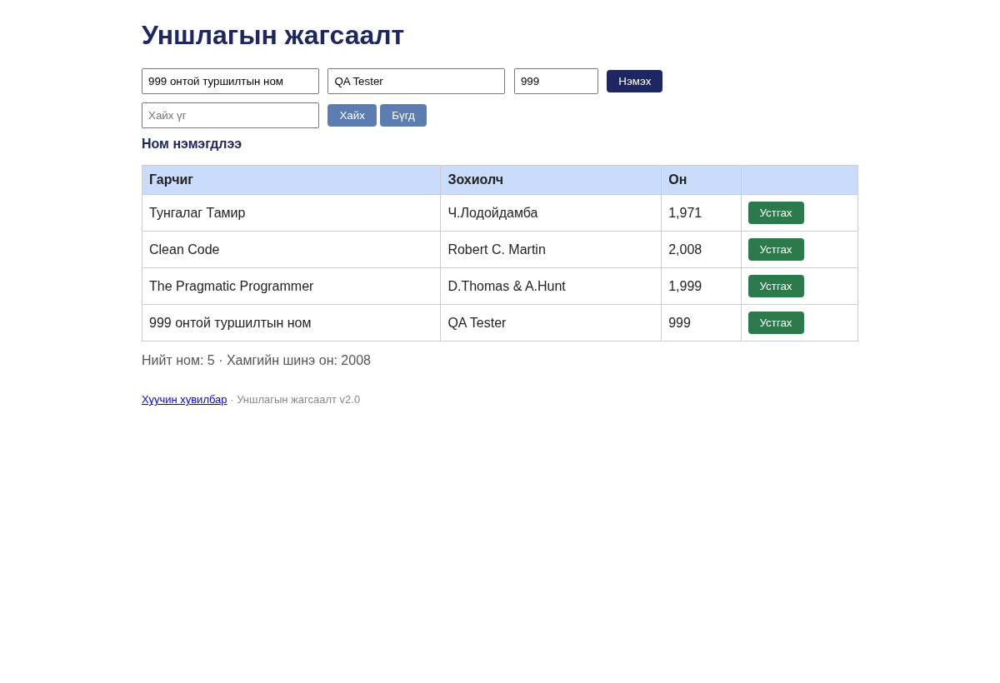

# BUG-02: 1000-аас бага оноор ном нэмэхийг зөвшөөрч байна

**Орчин:** «Уншлагын жагсаалт» v2.0; багшийн `app.js`; бодит шалгалтад Node.js v22.16.0, Chromium 144.0.7559.96 (headless), 2026-10-20.  
**Урьдчилсан нөхцөл:** `node app.js`-ийг шинээр асаасан, анхны **3 номтой** төлөв.  
**Статус:** `Reproduced — automated browser/API check` 

## Дахин гаргах алхам

1. Аппыг шинээр асаана.
2. Гарчиг: `999 онтой туршилтын ном`, зохиолч: `QA Tester`, он: `999` оруулна.
3. «Нэмэх» товчийг дарна.
4. Хүснэгтийн шинэ мөрийг харна.

## Хүлээгдэж байсан

Он 1000–2100 хоорондох бүхэл тоо биш тул ном нэмэгдэхгүй.

## Бодит ажиглалт

`999` онтой шинэ ном хүснэгтэд нэмэгдсэн.

## Ноцтой байдал

**Major** — Номын жилийн зааг зөрчигдөж буруу өгөгдөл хадгалагдана.

## Олдсон аялал / хэрэглэсэн арга

**Couch Potato**-ын тестийн санаагаар хийсэн автомат баталгаажуулалт.

## Нотолгоо

