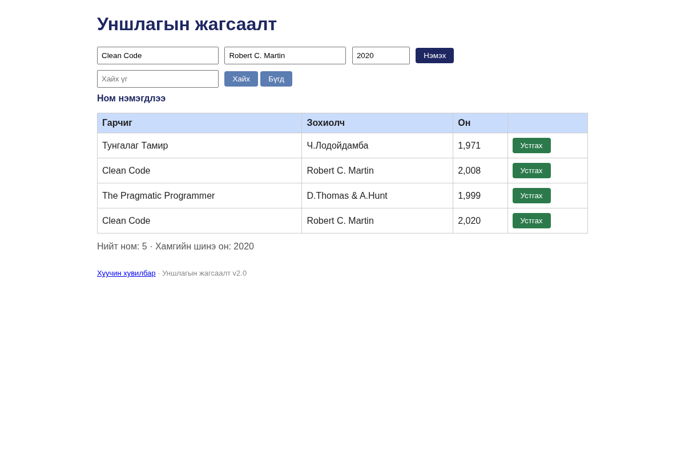

# BUG-03: Давхардсан гарчиг, зохиолчтой ном хоёр удаа бүртгэгдэж байна

**Орчин:** «Уншлагын жагсаалт» v2.0; багшийн `app.js`; бодит шалгалтад Node.js v22.16.0, Chromium 144.0.7559.96 (headless), 2026-10-20.  
**Урьдчилсан нөхцөл:** `node app.js`-ийг шинээр асаасан, анхны **3 номтой** төлөв.  
**Статус:** `Reproduced — automated browser/API check` 

## Дахин гаргах алхам

1. Аппыг шинээр асааж `Clean Code` / `Robert C. Martin` ном байгааг шалгана.
2. Гарчиг: `Clean Code`; Зохиолч: `Robert C. Martin`; Он: `2020` оруулна.
3. «Нэмэх» товчийг дарна.
4. Хүснэгтэд `Clean Code` гарчигтай мөрийг тоолно.

## Хүлээгдэж байсан

Ижил гарчиг, зохиолчтой ном дахин нэмэгдэхгүй; ойлгомжтой мэдэгдэл гарна.

## Бодит ажиглалт

`Clean Code` гарчиг, `Robert C. Martin` зохиолчтой 2 мөр гарсан.

## Ноцтой байдал

**Major** — Номын жагсаалтад давхардсан өгөгдөл үүсгэж байна.

## Олдсон аялал / хэрэглэсэн арга

**Fed-Ex**-ын тестийн санаагаар хийсэн автомат баталгаажуулалт.

## Нотолгоо

