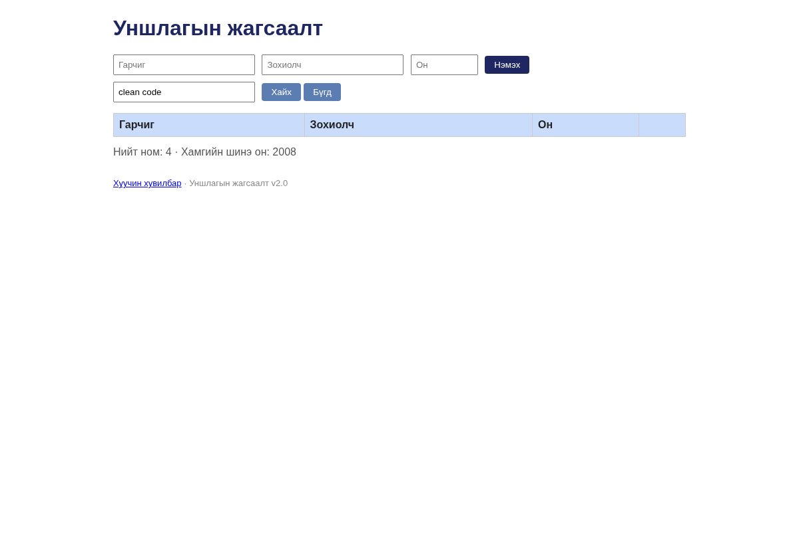

# BUG-04: Хайлт том, жижиг үсэг ялгаж буруу хоосон үр дүн үзүүлж байна

**Орчин:** «Уншлагын жагсаалт» v2.0; багшийн `app.js`; бодит шалгалтад Node.js v22.16.0, Chromium 144.0.7559.96 (headless), 2026-10-20.  
**Урьдчилсан нөхцөл:** `node app.js`-ийг шинээр асаасан, анхны **3 номтой** төлөв.  
**Статус:** `Reproduced — automated browser/API check` 

## Дахин гаргах алхам

1. Аппыг шинээр асааж `Clean Code` ном байгааг харна.
2. Хайх үг дээр `clean code` гэж жижиг үсгээр бичнэ.
3. «Хайх» товчийг дарна.
4. Хайлтын үр дүнг ажиглана.

## Хүлээгдэж байсан

Case-insensitive хайлт `Clean Code` номыг буцаана.

## Бодит ажиглалт

Үр дүнгийн хүснэгтэд 0 мөр гарсан.

## Ноцтой байдал

**Major** — Хэрэглэгч байгаа номоо олохгүйд хүрнэ.

## Олдсон аялал / хэрэглэсэн арга

**Supermodel**-ын тестийн санаагаар хийсэн автомат баталгаажуулалт.

## Нотолгоо

