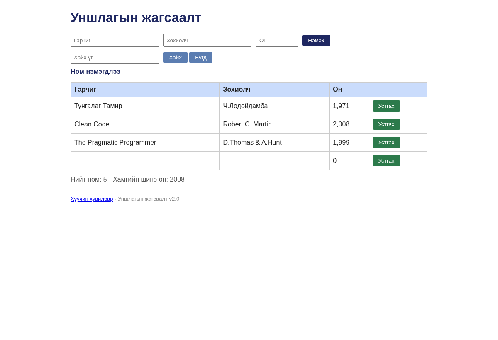
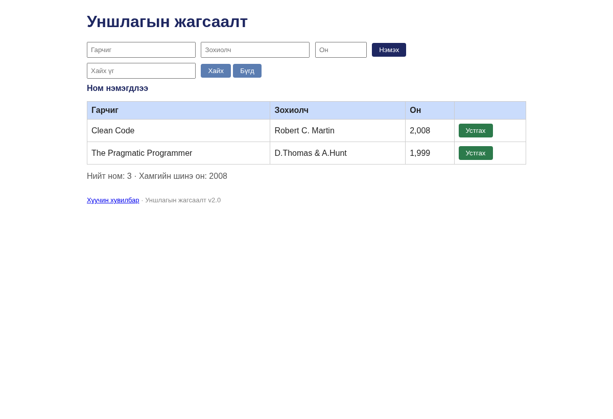
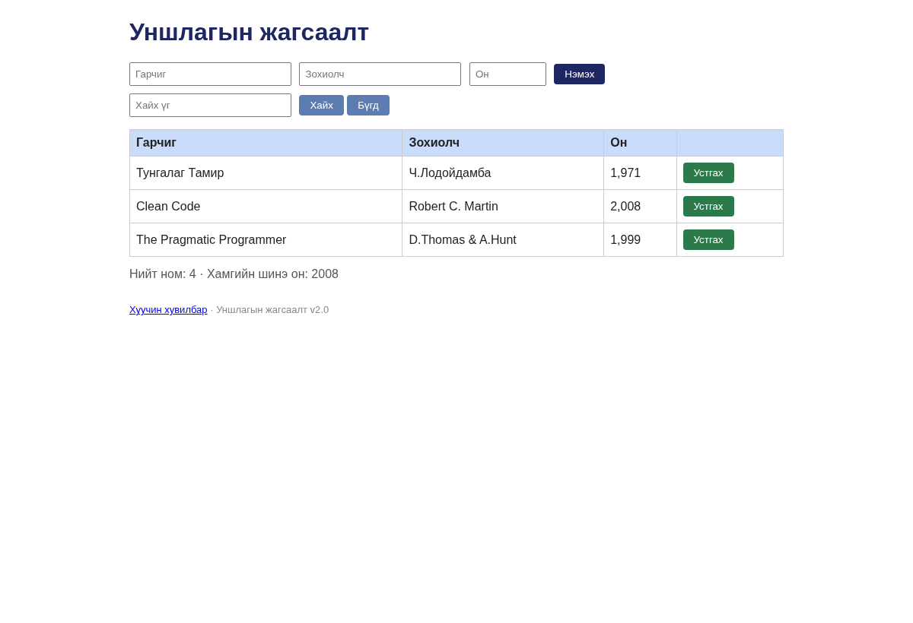

# Session report — Exploratory тестийн ажиглалтын бүртгэл

**Тестер:** Ө. Анар (B242270129)  
**Огноо:** 2026-10-20  
**60 минутын төлөвлөсөн цаг:** 21:20–22:20 (биелэлтийн нотолгоо биш)  
**Mission:** «Уншлагын жагсаалт» v2.0 вэб аппын чанарыг шинжлэх  
**Charter:** [`charter.md`](charter.md) — ном нэмэх, хайх, устгах, тоолуур, линк ба API-ийг турших.  
**Аяллууд:** Supermodel, Couch Potato, Saboteur; үр дүнг Fed-Ex өгөгдлийн замын өнцгөөр нэмж шалгасан.  
**Хэрэгсэл:** Node.js v22.16.0, Chromium 144.0.7559.96 (headless), HTTP `curl -i`.

## Тэмдэглэл (он цагийн дарааллаар)

```text
21:27:54  [Couch Potato] Нэмэх товчийг бүх талбарыг хоосон орхин дарав → Эхэнд 3 ном → 4 ном; мессеж: 'Ном нэмэгдлээ'.  → BUG-01
21:27:54  [Couch Potato] Он=999, бусад талбар бүрэн бөглөж нэмэв → Он=999 бүхий ном хүснэгтэд нэмэгдсэн: True.  → BUG-02
21:27:55  [Fed-Ex] Одоо байгаа Clean Code / Robert C. Martin нэртэй номыг өөр оноор дахин нэмэв → Clean Code гэсэн 2 мөр харагдсан.  → BUG-03
21:27:56  [Supermodel] Хайлтад clean code (жижиг үсгээр) оруулж Хайх дарсан → 0 мөр буцсан.  → BUG-04
21:27:57  [Supermodel] Эхний ном дээр Устгах дарсан → Номын мөр 3→2 болов, мессеж: 'Ном нэмэгдлээ'.  → BUG-05
21:27:57  [Fed-Ex] Аппыг шинээр нээж Нийт ном тоолуурыг хүснэгтийн мөрийн тоотой харьцуулав → Хүснэгт: 3 мөр; статистик: 'Нийт ном: 4 · Хамгийн шинэ он: 2008'.  → BUG-06
21:27:58  [Supermodel/Saboteur] Footer дахь Хуучин хувилбар холбоосын /old endpoint шалгав → HTTP 500; body: 'HTTP/1.1 500 Internal Server Error\nContent-Type: text/plain; charset=utf-8\nDate: Tue, 20 Oct 2026 13:27:58 GMT\nConnection: keep-alive\nKeep-Alive: timeout=5\nTransfer-Encoding: chunked\n\nInternal Server Error'.  → BUG-07
21:27:58  [Saboteur] POST /api/books руу malformed JSON илгээв → HTTP 200; хариу: 'HTTP/1.1 200 OK\nContent-Type: application/json\nDate: Tue, 20 Oct 2026 13:27:58 GMT\nConnection: keep-alive\nKeep-Alive: timeout=5\nTransfer-Encoding: chunked\n\n{"result":"OK"}'.  → BUG-08
```

UI шалгалт бүрийн өмнө апп шинээр асаасан анхны 3 номтой төлөв ашигласан. Ажиглалтын машинд браузерын localhost руу шууд навигац хаалттай байсан тул server-ийн жинхэнэ HTML-ийг Chromium in-memory хуудсанд дүрслэн, браузераас үүсэх fetch хүсэлтүүдийг локал API руу дамжуулж шалгасан. API нотолгоо нь HTTP header ба response body-той жинхэнэ `curl -i` гаралт юм.

## Согог ба нотолгооны холбоос

| BUG | Туршилтын үр дүн | Аялал | Нотолгоо |
|---|---|---|---|
| [BUG-01](bugs/bug-01.md) | Хоосон талбаруудтай ном нэмэгдэнэ | Couch Potato |  |
| [BUG-02](bugs/bug-02.md) | 999 оныг зөвшөөрнө | Couch Potato |  |
| [BUG-03](bugs/bug-03.md) | Давхардсан ном нэмэгдэнэ | Fed-Ex |  |
| [BUG-04](bugs/bug-04.md) | `clean code` хайлт 0 мөр | Supermodel |  |
| [BUG-05](bugs/bug-05.md) | Устгахад «Ном нэмэгдлээ» | Supermodel |  |
| [BUG-06](bugs/bug-06.md) | Хүснэгт 3 / тоолуур 4 | Fed-Ex |  |
| [BUG-07](bugs/bug-07.md) | `/old` → HTTP 500 | Saboteur | [`curl`](evidence/bug-07-curl.txt) |
| [BUG-08](bugs/bug-08.md) | Malformed JSON → HTTP 200 | Saboteur | [`curl`](evidence/bug-08-curl.txt) |

## Саадууд (issues)

- Автомат шалгалтын Chromium ажлын орчин localhost direct navigation-ийг хязгаарласан. DOM ба серверийн хариуг proxy ашиглан холбосон; Debian Firefox/Chromium дээр энгийн гараар дахин шалгах хэрэгтэй.
- Апп өгөгдлөө санах ойд хадгалдаг тул bug бүрийн хамгийн цөөн алхмыг сэргээн ажиллуулахдаа серверийг restart хийх шаардлагатай.
- Хайлтын үед «Нийт ном» тоолуур нийт сангийн тоог харуулах уу эсвэл хайлтын мөрийн тоог харуулах уу гэдэг нь тодорхой биш. Тиймээс хайлттай холбоотой тоолуурын өөрчлөлтийг нэмэлт согог гэж бүртгээгүй.

## Цагийн задаргаа

**60 минутын SBTM session-ийг хийгдсэн гэж тайлагнаагүй тул** бодит хувь хараахан тодорхойгүй:

Setup `5%` · Тест дизайн ба гүйцэтгэл `55%` · Согог судлах `40%`.

